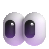
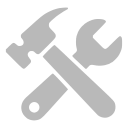
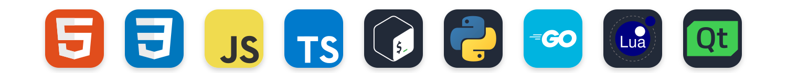
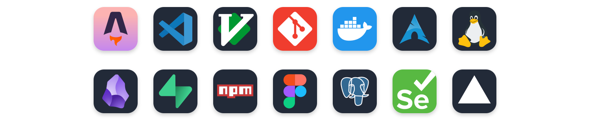
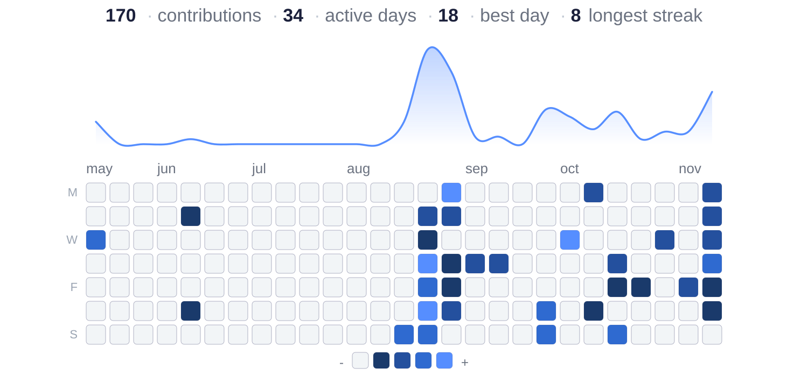

<!--header-->
#  Hi There!

I'm **Stezf**, an independent Software Developer.

I mainly work in my own projects & contributing with other users focusing on Backend-Logic core.

Moreover, I often setting up my own rice desktops, mostly using the Qt framework and other useful tools.

##  What Drives Me
I build to learn and share to grow. Every project solves a real problem and teaches me something new, including the open-source community gets it all.

<!--tools-->
##  Stack & Tool Box

<!-- languages.svg-->

  

<!-- tools.svg-->

  

<!-- stats.svg-->
##  Stats

### Contact in Bio. 

